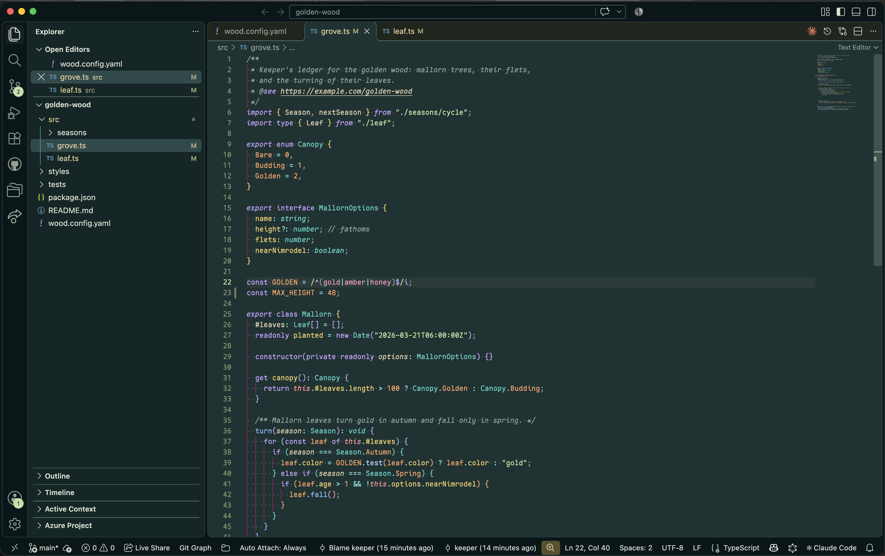
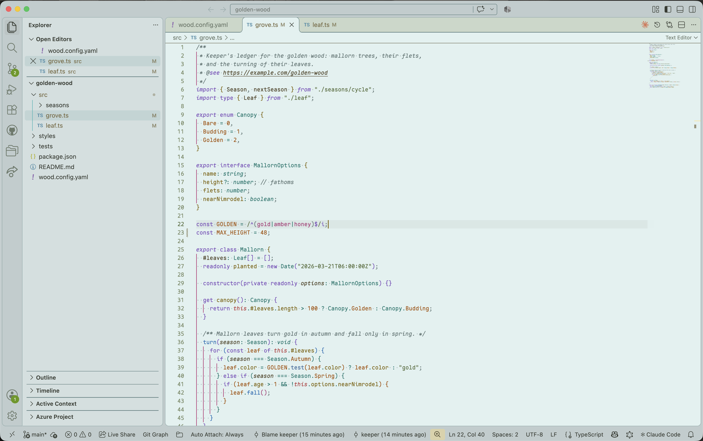

# Mallorn

Cream text on deep teal-green, with a matching light variant.





## Install

Search for **Mallorn** in the Extensions view, or run:

```
code --install-extension volfied.mallorn-theme
```

Then pick **Mallorn Dark** or **Mallorn Light** from *Preferences: Color Theme*.

## Notes

- Colors come from an OKLCH palette: accents share lightness and chroma, so no hue shouts over another.
- Light is derived from Dark by rule rather than hand-picked, and holds syntax colors to WCAG AA contrast against the editor.
- Indent guides are deliberately vivid. If you prefer quiet ones, override `editorIndentGuide.background1` and `editorIndentGuide.activeBackground1` under `workbench.colorCustomizations`.

## License

MIT
